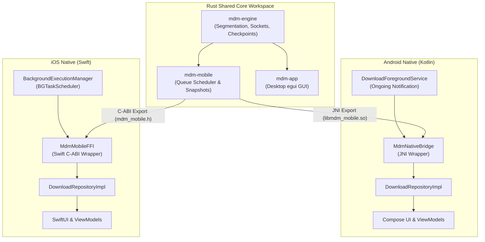
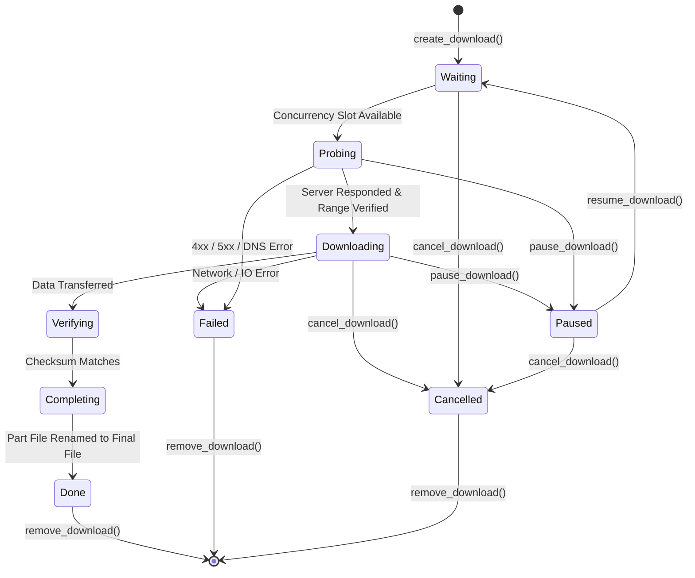

# Mister Download Manager (MDM)

<div align="center">


### High-Performance Native Cross-Platform Download Acceleration Engine & Frontends

[](https://github.com/anefzaoui/download-manager/actions/workflows/ci.yml)
[](https://github.com/anefzaoui/download-manager/releases)
[](LICENSE)
[](https://www.rust-lang.org/)
[-brightgreen.svg)](https://developer.android.com)
[](https://developer.apple.com/ios/)

**Desktop (Windows · Linux · macOS) · Mobile (Android · iOS) · Browser Extensions (Chromium · Firefox)**

</div>

---

## Overview

**Mister Download Manager (MDM)** is an ultra-fast, modern download manager engineered for multi-connection acceleration, dynamic file segmentation, and resilient resume recovery. 

Built as a unified monorepo, MDM pairs a shared, memory-safe **Rust download engine core** directly with **100% native frontends** for each platform (Android with Kotlin & Jetpack Compose, iOS with Swift & SwiftUI, and Desktop with Rust & `egui`). This zero-compromise architecture guarantees top-tier performance, minimal memory footprints, and authentic platform UX without the overhead of hybrid runtimes (React Native, Electron, or Flutter).

---

## Table of Contents

1. [Features & Capabilities](#features--capabilities)
2. [Platform & Feature Support Matrix](#platform--feature-support-matrix)
3. [Brand Identity & Color Palette](#brand-identity--color-palette)
4. [Build Variants & Output Artifacts](#build-variants--output-artifacts)
5. [Release Workflow & Checksum Verification](#release-workflow--checksum-verification)
6. [Repository Structure](#repository-structure)
7. [System Architecture & Data Flow](#system-architecture--data-flow)
8. [Build & Local Development Setup](#build--local-development-setup)
   - [Local Android APK Build](#local-android-apk-build)
   - [Docker Build Pipeline](#docker-build-pipeline)
   - [Desktop App Build](#desktop-app-build)
   - [iOS Setup](#ios-setup)
9. [Contributing & Code Standards](#contributing--code-standards)
10. [Download Lifecycle State Machine](#download-lifecycle-state-machine)
11. [Troubleshooting](#troubleshooting)
12. [Contributors & Core Team](#contributors--core-team)
13. [Attribution & License](#attribution--license)

---

## Features & Capabilities

- **Dynamic File Segmentation:** Real-time stream splitting with concurrent connection pooling across all available bandwidth.
- **Resilient Resume & Checkpoint Persistence:** Transfer checkpoints and HTTP resume validators (ETags, Last-Modified) persist atomic state metadata to `<filename>.mdm.json`.
- **Zero-Copy Native FFI Bridge:** Dual foreign-function interfaces (JNI for Android, C-ABI for iOS) guarantee maximum transfer throughput with zero pointer hazards.
- **Android Foreground Service (`dataSync`):** Persistent, battery-conscious background execution with active notification channels complying with Android 14+ background execution policies.
- **BitTorrent Engine (Desktop):** Built-in torrent client engine (`crates/torrent`) powered by an optimized `librqbit` implementation with per-torrent rate limits.
- **Browser Integration:** Native messaging hosts and browser extensions for Chrome, Firefox, Edge, Brave, Opera, and Vivaldi.
- **Clean Room Engineering:** 100% original codebase written from scratch under the GNU General Public License v3.0.

---

## Platform & Feature Support Matrix

| Capability / Platform | Android Native (`android/`) | iOS Native (`ios/`) | Desktop (`crates/app`) | Core Engine (`crates/engine`) |
| :--- | :--- | :--- | :--- | :--- |
| **Multi-Connection HTTP/S** | **VERIFIED** | **VERIFIED** | **VERIFIED** | **VERIFIED** |
| **Dynamic Segmentation** | **VERIFIED** | **VERIFIED** | **VERIFIED** | **VERIFIED** |
| **Atomic Resume (`.mdm.json`)**| **VERIFIED** | **VERIFIED** | **VERIFIED** | **VERIFIED** |
| **Queue Scheduling & Limits** | **VERIFIED** | **VERIFIED** | **VERIFIED** | **VERIFIED** |
| **Speed Calculation & Telemetry**| **VERIFIED** | **VERIFIED** | **VERIFIED** | **VERIFIED** |
| **Background Execution** | **Foreground Service** (`dataSync`) | **BGTaskScheduler** | System Tray / Background | Dedicated Tokio Runtime |
| **User Interface** | Kotlin / Jetpack Compose | Swift / SwiftUI | Rust / `egui` | Headless Core / API |
| **BitTorrent Client** | Planned | Planned | **VERIFIED** | `crates/torrent` |
| **Browser Extension Integration**| Unsupported (Mobile) | Unsupported (Mobile) | **VERIFIED** | Native Host (`crates/nmhost`)|

---

## Brand Identity & Color Palette

The application's visual styling reflects the official mascot artwork (The Globe Gentleman with high-speed orbit arrow). All frontends adhere to these unified tokens and gradients:

### Official Brand Colors
| Color Role | Name | Hex Code | Android Theme Token | Description |
| :--- | :--- | :--- | :--- | :--- |
| **Primary Action** | Electric Blue | `#2563EB` / `#3B82F6` | `LightPrimary` / `DarkPrimary` | Primary buttons, active tabs, header highlights |
| **Active Transfer** | Vivid Emerald | `#10B981` / `#22C55E` | `StateDownloading` | Speed indicators, active progress bars, success markers |
| **Speed Accent** | Cyan Stream | `#06B6D4` / `#0284C7` | `DarkAccentCyan` / `LightAccentCyan` | Network throughput monitors, active connection segments |
| **Secondary Chip** | Royal Indigo | `#6366F1` / `#4F46E5` | `DarkSecondary` / `LightSecondary` | Metadata tags, filter chips, secondary badges |
| **Surface Dark** | Midnight Slate | `#0A0F1D` / `#131B2E` | `DarkBackground` / `DarkSurface` | Clean dark mode backgrounds and elevated card surfaces |

### Official Dynamic Gradients
- **Download Acceleration Gradient:** `linear-gradient(135deg, #10B981 0%, #06B6D4 100%)`  
  *Applied to live progress bars and active transfer speeds.*
- **Orbit Stream Gradient:** `linear-gradient(135deg, #06B6D4 0%, #3B82F6 100%)`  
  *Applied to connection metrics, charts, and header accents.*
- **Gentleman's Dark Surface:** `linear-gradient(180deg, #1B253D 0%, #0A0F1D 100%)`  
  *Applied to bottom sheets, modal headers, and drawer backgrounds.*

### Semantic Download States
- 🟢 **Downloading:** Emerald Green (`#10B981`)
- 🔵 **Done (Complete):** Solid Blue (`#3B82F6`)
- 🟡 **Paused:** Warning Amber (`#F59E0B`)
- 🔴 **Failed:** Coral Red (`#EF4444`)
- 🟣 **Probing (Connecting):** Deep Violet (`#8B5CF6`)
- ⚪ **Waiting (Queued):** Slate Gray (`#64748B`)

*For full guidelines, see the [Design Tokens Specification](.agents/rules/DESIGN_TOKENS_AND_PALETTE.md).*

---

## Build Variants & Output Artifacts

MDM provides production-ready artifacts tailored for mobile, desktop, and web platforms:

### 1. Android Artifacts (`android/`)
| Build Variant | Output File | Target Audience & Purpose |
| :--- | :--- | :--- |
| **Debug APK** | `app-debug.apk` | Rapid local testing, contains debug logging and full symbol tables. |
| **Release APK** | `app-release-unsigned.apk` | Standalone direct install APK for sideloading and GitHub Releases. |
| **Release AAB** | `app-release.aab` | Google Play App Bundle with dynamic feature delivery and ABI splits. |
| **Native Shared Libs** | `libmdm_mobile.so` | Compiled JNI binaries for `arm64-v8a` (64-bit ARM) and `x86_64` (Emulators/x86). |

### 2. Desktop Artifacts (`crates/app`)
| Platform | Distribution Format | Description |
| :--- | :--- | :--- |
| **Windows** | Inno Setup Installer (`.exe`) & Portable (`.zip`) | Self-contained executable with system tray & shell registration. |
| **Linux** | AppImage, `.deb`, `.rpm`, `.tar.gz` | Universal desktop packages compiled against glibc 2.35+. |
| **macOS** | Universal Disk Image (`.dmg`) | Bundled for Apple Silicon (`aarch64`) and Intel (`x86_64`). |

### 3. Browser Extensions (`extension/`)
| Browser Engine | Package Format | Distribution Channel |
| :--- | :--- | :--- |
| **Chromium** | `MisterDownloadManager-<v>-extension-chromium.zip` | Chrome, Edge, Brave, Opera, Vivaldi |
| **Firefox** | `MisterDownloadManager-<v>-extension-firefox.xpi` | Mozilla Add-ons (AMO) & manual sideload |

---

## Release Workflow & Checksum Verification

### Automated GitHub Release Process
Releases are triggered automatically whenever a version tag matching `vX.Y.Z` is pushed to GitHub:

```bash
git tag v0.5.2
git push origin v0.5.2
```

The automated CI/CD workflow ([`.github/workflows/release.yml`](.github/workflows/release.yml)) performs:
1. Workspace version consistency check against `Cargo.toml`.
2. Cross-platform compilation for Windows, Linux, macOS, Android, and Browser Extensions.
3. Collection of all binaries into the unified distribution directory.
4. Computation of cryptographic checksums (`SHA256SUMS.txt`).
5. GPG detached signing of checksums using the official MDM release key (`5826D399249DE856EA087D802E293C28E8A69D74`).
6. Automatic creation of the GitHub Release with generated changelog notes.

### Cryptographic Verification of Downloads
Verify any release binary using the detached signature and SHA-256 table:

```bash
# 1. Import the official public release key
gpg --import crates/tools/keys/mdm-release.asc

# 2. Verify the checksum table signature
gpg --verify SHA256SUMS.txt.sig SHA256SUMS.txt

# 3. Verify downloaded artifact integrity
sha256sum -c SHA256SUMS.txt --ignore-missing
```

### Android Release Signing Configuration
To sign release APKs or AAB bundles, provide signing keys via environment variables or mounting:

```bash
export KEYSTORE_FILE=/path/to/release.keystore
export KEYSTORE_PASSWORD="your-keystore-password"
export KEY_ALIAS="mdm"
export KEY_PASSWORD="your-key-password"
```

---

## Repository Structure

```
download-manager-android/
├── Cargo.toml                         # Root Cargo workspace manifest
├── package.json                       # Developer task scripts (npm run apk, etc.)
├── compose.yaml                       # Multi-stage Docker build pipeline
├── Dockerfile.mobile                  # Multi-stage container definition
├── .gitignore                         # Comprehensive ignore file
├── .dockerignore                      # Minimal Docker context ignore
├── CONTRIBUTING.md                    # Official contribution guide & workflow
├── crates/
│   ├── engine/                        # Core download engine (mdm-engine)
│   ├── mobile/                        # Mobile FFI bridge & snapshot scheduler (mdm-mobile)
│   ├── app/                           # Native desktop application (egui / winit)
│   ├── cli/                           # Command line interface client
│   ├── labserver/                     # Local test server with fault-injection
│   ├── nmhost/                        # Native messaging host for browsers
│   └── torrent/                       # BitTorrent client engine (librqbit)
├── android/                           # Native Android application (Kotlin / Compose)
│   ├── app/                           # App module (Presentation, Domain, Data, Services)
│   │   └── src/main/jniLibs/          # Precompiled libmdm_mobile.so binaries
│   └── gradlew                        # Gradle build wrapper
├── ios/                               # Native iOS application (Swift / SwiftUI)
│   └── MisterDownloadManager/         # Presentation, ViewModels, C-ABI FFI wrapper
├── extension/                         # Browser extensions (Chrome / Firefox)
├── tools/                             # Automation, packaging, and build scripts
└── docs/                              # Technical guides and architecture specs
```

---

## System Architecture & Data Flow



---

## Build & Local Development Setup

### Local Android APK Build
The Android application can be compiled directly on any Linux/macOS machine equipped with standard Android development tools:

1. **Configure Environment Variables:**
   ```bash
   export JAVA_HOME="/path/to/java-17"
   export ANDROID_HOME="$HOME/Android/Sdk"
   export ANDROID_NDK_HOME="$ANDROID_HOME/ndk/27.1.12297006"
   export PATH="$JAVA_HOME/bin:$ANDROID_HOME/platform-tools:$PATH"
   ```

2. **Add Rust Android Targets:**
   ```bash
   rustup target add aarch64-linux-android x86_64-linux-android
   ```

3. **Build Native JNI Libraries:**
   ```bash
   npm run build:libs
   # or: bash tools/build-android-libs.sh
   ```

4. **Build Android Debug APK:**
   ```bash
   npm run apk
   # Output located at: android/app/build/outputs/apk/debug/app-debug.apk
   ```

5. **Install on Connected Device / Emulator:**
   ```bash
   adb install -r android/app/build/outputs/apk/debug/app-debug.apk
   ```

---

### Docker Build Pipeline
If you prefer building without configuring Android SDK/NDK dependencies on your host machine, utilize the Docker Compose pipeline:

```bash
# Build complete pipeline and export artifacts to ./build-output/
docker compose up --build
```

Target individual stages:
```bash
# Compile Android native .so libraries only
docker compose up --build android-libs

# Compile Android APKs only
docker compose up --build android-app
```

*For complete details, see [Docker Build Pipeline Documentation](docs/DOCKER_BUILD.md).*

---

### Desktop App Build
Compile and run the native desktop application on Windows, Linux, or macOS:

```bash
# Check code compatibility
cargo check -p mdm-app

# Build and launch desktop app
cargo run -p mdm-app
```

---

### iOS Setup
1. Cross-compile the Rust static library for iOS:
   ```bash
   rustup target add aarch64-apple-ios x86_64-apple-ios aarch64-apple-ios-sim
   ./tools/build-ios-libs.sh
   ```
2. Open the Xcode project located at `ios/MisterDownloadManager/MisterDownloadManager.xcodeproj`.

---

## Contributing & Code Standards

We welcome community contributions! Please review our [**CONTRIBUTING.md**](CONTRIBUTING.md) guide before submitting a pull request.

### Pre-PR Verification Suite
Before opening a Pull Request, ensure that all automated checks pass locally:

```bash
# 1. Format verification
cargo fmt --all --check

# 2. Strict Clippy lint check
cargo clippy --workspace --all-targets -- -D warnings

# 3. Test suite execution
cargo test --workspace

# 4. English catalog synchronization
python tools/i18n/extract.py
git diff --exit-code -- i18n/en.tsv

# 5. Browser extension test suite
node tools/extension/test.mjs
```

---

## Download Lifecycle State Machine



---

## Troubleshooting

1. **`UnsatisfiedLinkError` on Android:**  
   Ensure native libraries are compiled and present in `android/app/src/main/jniLibs/arm64-v8a/libmdm_mobile.so`. Run `npm run build:libs` to compile them.
2. **Missing Android Targets in Rust:**  
   Execute `rustup target add aarch64-linux-android x86_64-linux-android`.
3. **Android Studio SDK Path:**  
   If Android Studio complains about missing SDK, set `sdk.dir` in `android/local.properties` (note: `local.properties` is safely ignored by Git).

---

## Contributors & Core Team

We express deep gratitude to everyone driving the engineering, mobile porting, and security audits of Mister Download Manager:

| Contributor | Role & Contributions | Profile |
| :--- | :--- | :--- |
| **Hwai Technology** | Project Organization & Ecosystem Lead | [@Hwai-technology](https://github.com/Hwai-technology) |
| **Ahmed Nefzaoui** | Original Creator & Core Desktop Engine Architect | [@anefzaoui](https://github.com/anefzaoui) |
| **Eng. Ahmet Asaad Hammoud** | Android Architecture, Rust Mobile Engine (`crates/mobile`), Jetpack Compose UI, CI/CD Pipelines & Security Hardening | [@Eng-Ahmet](https://github.com/Eng-Ahmet) |
| **Eng. Maya** | Quality Assurance, Cross-platform Testing & Community Contributions | [@Eng-Maya](https://github.com/Eng-Maya) |

*Want to contribute? Check out our [Contribution Guidelines](CONTRIBUTING.md) to get started!*

---

## Attribution & License

- **Repository:** [Hwai-technology/download-manager-android](https://github.com/Hwai-technology/download-manager-android)
- **Upstream Project:** Mister Download Manager v0.5.2
- **Original Author:** Ahmed Nefzaoui
- **License:** [GNU General Public License v3.0 or later (GPL-3.0-or-later)](LICENSE)
- **Technical Reference:** [Mobile Architecture Specification](docs/MOBILE_ARCHITECTURE.md)
